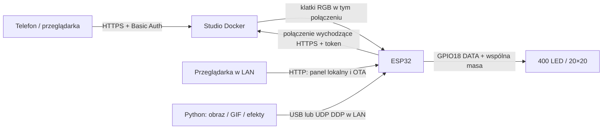
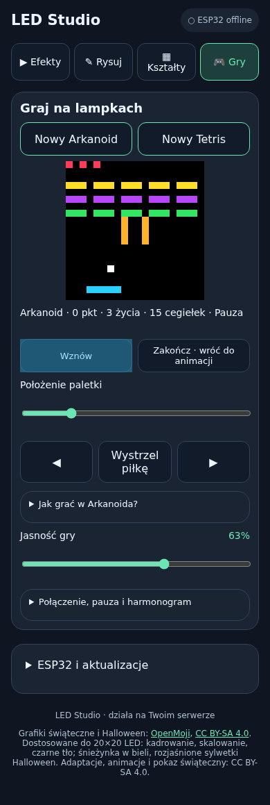
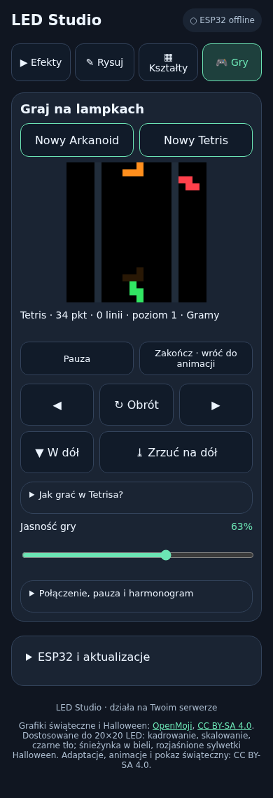
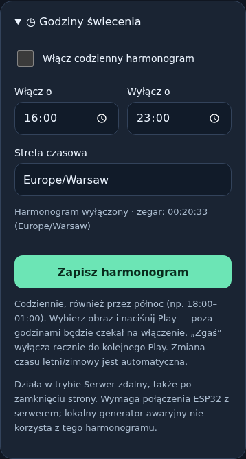
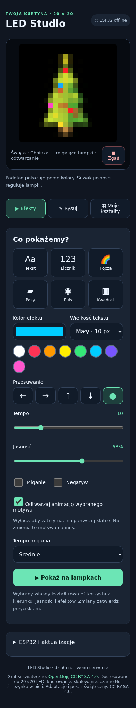
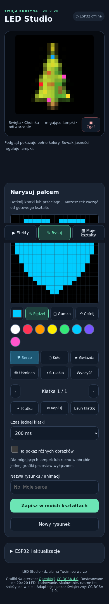
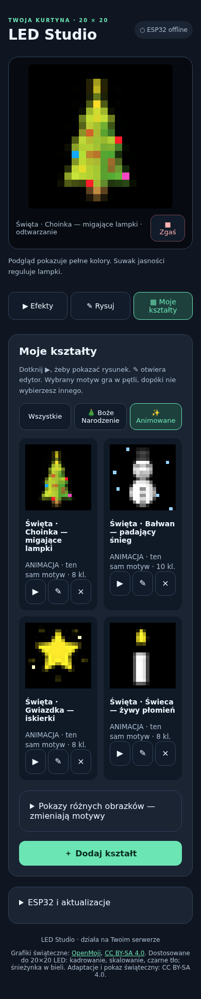
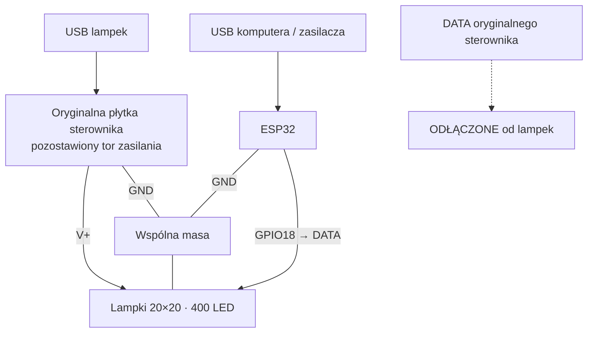

# LED 20×20 ESP32 Wi-Fi

Sterownik matrycy/kurtyny **400 adresowanych LED**, lokalny generator w ESP32 i dotykowe studio WWW uruchamiane w Dockerze. Telefon służy do wyboru efektów i rysowania; po zamknięciu przeglądarki animacja nadal działa.

Projekt zawiera kod firmware, serwera, nadajnika USB/DDP, grafiki świąteczne i instrukcje. Nie zawiera danych prywatnej instalacji ani gotowych binarek z danymi Wi-Fi. Interfejs i dokumentacja są po polsku.

## Jak to działa

ESP32 ma trzy wybierane źródła obrazu:

| Tryb | Skąd pochodzi obraz | Czy potrzebny serwer? |
|---|---|---|
| Generator w ESP32 | Tekst, licznik, tęcza, pasy, pulsowanie, odbijający się punkt | Nie |
| Serwer zdalny | Studio WWW, zapisane kształty i animacje | Tak; przy utracie danych pozostaje ostatnia klatka (firmware 2.4) |
| Aplikacja USB / DDP | Python, obrazy i GIF-y wysyłane z komputera | Nie |

Lokalny panel pozwala ustawić kierunek (lewo/prawo/góra/dół/bez ruchu), kolor, jasność, miganie, negatyw, skalę tekstu, układ przewodów i kolejność RGB. Konfigurację można zapisać w pamięci ESP32.

Studio zdalne dodaje rysowanie palcem, gumkę, cofanie, gotowe stemple, bibliotekę do 100 kształtów i animacje do 32 klatek. **Play wyświetla tylko wybrany motyw w pętli.** Pokaz różnych obrazków jest osobnym typem. Animację można zatrzymać na pierwszej klatce. Pakiet świąteczny zawiera 10 obrazów, pokaz oraz 4 animacje, np. choinkę z migającymi lampkami.

## Utrata połączenia z serwerem

Od firmware **2.4** lampki zachowują ostatnią kompletną klatkę podczas przerwy w transmisji. Nie przełączają się na zapisany lokalny tekst. Po powrocie danych wyświetlanie wznawia się automatycznie. Po restarcie ESP32 zaczyna od czarnego obrazu do otrzymania pierwszej klatki; obraz nie jest zapisywany do Flash.

Starszy firmware 2.3 uruchamiał lokalny generator po około 3 sekundach bez danych. Ta zmiana wymaga [aktualizacji ESP32 przez OTA](docs/WDROZENIE.md#ota-bez-kabla), sama aktualizacja Dockera nie wystarcza.

[Dokumentacja firmware 2.4: zachowanie, aktualizacja, diagnostyka i test na urządzeniu](docs/FIRMWARE_2_4.md).

## Gry na lampkach

W zakładce **🎮 Gry** można uruchomić **Arkanoida** lub **Tetrisa** i grać przyciskami dotykowymi albo klawiaturą. Plansza jest wysyłana na LED-y jako klatki 20×20. Są pauza, jasność gry, wynik, życia oraz automatyczna pauza po utracie sterowania. Zakończenie przywraca poprzednią animację. Wymagany tryb ESP32: **Serwer zdalny**; bez aktualizacji firmware.

[Instrukcja, sterowanie, zrzuty ekranu i ograniczenia](docs/GRY.md). Gra jest wspólna dla danej instancji serwera, respektuje harmonogram i nie zapisuje rozgrywki po restarcie.

**Działanie gier na fizycznej matrycy LED zostało potwierdzone przez użytkownika.** Poniżej podglądy interfejsu mobilnego z instalacji demonstracyjnej:

| Arkanoid — paletka i cegiełki | Tetris — spadające klocki |
|---|---|
|  |  |

## Halloween

Pakiet zawiera **7 obrazów i 3 animacje**: dynię, ducha, nietoperza, czaszkę, pająka, pajęczynę i świeczkę, a także świecącą dynię, lewitującego ducha oraz świeczkę z migoczącym płomieniem. Po imporcie wybierz **Moje kształty → Halloween** lub **Animowane**.

[Podgląd, import i źródła grafik Halloween](remote_app/halloween/README.md). Kształt pozostaje wybrany; animacje nie przechodzą samoczynnie do innych obrazków.

## Film na 20×20 — możliwości

Możliwe jest przekształcenie AVI/MP4 w klatki RGB 20×20. Zobacz [demonstrację konwersji, animowany podgląd i ograniczenia](docs/WIDEO.md). Przykład sprawdzono na komputerze; import filmów w panelu WWW pozostaje funkcją do implementacji.

## Godziny świecenia

W panelu WWW rozwiń **„Godziny świecenia”**, włącz harmonogram i ustaw godzinę włączenia oraz wyłączenia. Domyślna strefa to `Europe/Warsaw`, ze zmianą czasu letniego/zimowego. Przedziały przez północ, np. 18:00–01:00, są obsługiwane.

Harmonogram działa codziennie na serwerze, także po zamknięciu przeglądarki i restarcie aplikacji. Wybierz scenę i naciśnij Play; poza godzinami serwer wysyła czarne klatki. „Zgaś” pozostaje ręcznym wyłączeniem do kolejnego Play. Harmonogram dotyczy trybu **Serwer zdalny z aktywnym połączeniem** — przy utracie łącza firmware 2.4 zachowuje ostatnią klatkę, a zmiana harmonogramu czeka na powrót transmisji. Tryby lokalny i USB/DDP są niezależne.

## Zrzuty ekranu

Poniższe ekrany pochodzą z lokalnej instalacji demonstracyjnej. Nie przedstawiają rzeczywistej instalacji ani połączonego sprzętu.

| Efekty i podgląd | Edytor dotykowy | Biblioteka animacji |
|---|---|---|
|  |  |  |

## Zacznij tutaj

1. [Sprzęt, pierwsze wgranie i uruchomienie ESP32](docs/WDROZENIE.md#1-sprzęt-i-firmware).
2. [Wdrożenie studia Docker z HTTPS](docs/WDROZENIE.md#2-serwer-docker).
3. [Pierwszy obraz, import świątecznych grafik i OTA](docs/WDROZENIE.md#3-uruchomienie-i-obsługa).
4. [API, protokoły, ograniczenia i testy](docs/ARCHITEKTURA.md).

## Zgodność i zasilanie

Testowano klasyczne ESP32 (ESP32-D0WD, 4 MB Flash) i jedną kurtynę 20×20. Model układów LED nie został jednoznacznie ustalony. Firmware wysyła RGB24: bit 0 = 250 ns HIGH + 750 ns LOW, bit 1 = 750 ns HIGH + 250 ns LOW, przerwa 600 µs. **Nie jest to deklaracja zgodności ze wszystkimi WS281x.** Dla innej matrycy sprawdź napięcie, timing i kolejność kanałów.

W opisanym podłączeniu **lampki są zasilane z własnego USB przez oryginalną płytkę**, a ESP32 z osobnego USB. Do ESP32 podłączamy DATA lampek (GPIO18) i wspólną masę GND; wyjście DATA oryginalnego sterownika odłączamy. Zobacz [schemat i kolejność podłączenia](docs/WDROZENIE.md#połączenia--zasilanie-z-usb-lampek).

GPIO18 jest linią danych, nie zasilaniem LED. Użyj zasilacza dobranego do napięcia i poboru swojej matrycy, wspólnej masy i w razie potrzeby konwertera poziomów. Zacznij od niskiej jasności (domyślnie 24/255). Nie zasilaj 400 LED z wyjścia 3V3 ESP32.

## Schemat podłączenia do oryginalnego sterownika lampek

Lampki pozostają zasilane ze swojego USB przez oryginalną płytkę. ESP32 jest zasilane osobnym USB. Łączymy je z lampkami tylko przez **DATA i wspólną masę GND**.

| Połączenie | Sposób podłączenia |
|---|---|
| Zasilanie lampek V+ i GND | Pozostaje na oryginalnej płytce zasilanej z USB lampek |
| GPIO18 ESP32 | Do przewodu DATA prowadzącego do pierwszej lampki |
| GND ESP32 | Do GND lampek / oryginalnej płytki |
| USB ESP32 | Osobne zasilanie ESP32 |
| 3V3 i 5V/VIN ESP32 | Nie podłączamy do V+ lampek |

**Przed podłączeniem GPIO18 odłącz DATA oryginalnego sterownika od przewodu prowadzącego do lampek.** Nie łącz dwóch wyjść DATA równolegle. Prace wykonuj przy odłączonych obu USB. Jeżeli poziom sygnału wymaga dopasowania, umieść konwerter poziomów w torze GPIO18 → DATA; opcjonalny rezystor szeregowy nie zastępuje konwertera.

[Pełna instrukcja podłączenia i pierwszego testu](docs/WDROZENIE.md#połączenia--zasilanie-z-usb-lampek).

## Struktura i licencje

- `esp32_led_standalone/` — firmware Arduino, lokalne WWW, HTTPS, OTA, font.
- `remote_app/` — serwer aiohttp/Pillow, interfejs mobilny, Docker i testy.
- `remote_app/christmas/` — grafiki, źródła, generatory i importer.
- `esp32_led_stream/stream.py` — nadajnik USB/DDP i GIF.
- `docs/` — wdrożenie, API i zrzuty ekranu.

Własny kod projektu: [MIT](LICENSE). Grafiki OpenMoji (Boże Narodzenie i Halloween) i ich przetworzone wersje: **CC BY-SA 4.0**, autorzy i źródła w [licencji grafik](remote_app/christmas/LICENSE.txt) i `sources.json`. Licencję przykładowego filmu i autora podano w [opisie demonstracji](docs/WIDEO.md). Font DejaVu ma osobne warunki w `FONT_LICENSE.txt` w obu katalogach aplikacji. Licencje bibliotek i Arduino ESP32 pozostają odrębne.
