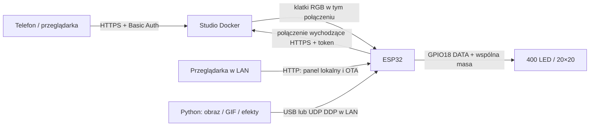

# LED 20×20 ESP32 Wi-Fi

Sterownik matrycy/kurtyny **400 adresowanych LED**, lokalny generator w ESP32 i dotykowe studio WWW uruchamiane w Dockerze. Telefon służy do wyboru efektów i rysowania; po zamknięciu przeglądarki animacja nadal działa.

Projekt zawiera kod firmware, serwera, nadajnika USB/DDP, grafiki świąteczne i instrukcje. Nie zawiera danych prywatnej instalacji ani gotowych binarek z danymi Wi-Fi. Interfejs i dokumentacja są po polsku.

## Jak to działa

ESP32 ma trzy wybierane źródła obrazu:

| Tryb | Skąd pochodzi obraz | Czy potrzebny serwer? |
|---|---|---|
| Generator w ESP32 | Tekst, licznik, tęcza, pasy, pulsowanie, odbijający się punkt | Nie |
| Serwer zdalny | Studio WWW, zapisane kształty i animacje | Tak; przy braku danych przez ok. 3 s działa lokalny generator awaryjny |
| Aplikacja USB / DDP | Python, obrazy i GIF-y wysyłane z komputera | Nie |

Lokalny panel pozwala ustawić kierunek (lewo/prawo/góra/dół/bez ruchu), kolor, jasność, miganie, negatyw, skalę tekstu, układ przewodów i kolejność RGB. Konfigurację można zapisać w pamięci ESP32.

Studio zdalne dodaje rysowanie palcem, gumkę, cofanie, gotowe stemple, bibliotekę do 100 kształtów i animacje do 32 klatek. **Play wyświetla tylko wybrany motyw w pętli.** Pokaz różnych obrazków jest osobnym typem. Animację można zatrzymać na pierwszej klatce. Pakiet świąteczny zawiera 10 obrazów, pokaz oraz 4 animacje, np. choinkę z migającymi lampkami.

## Zrzuty ekranu

Poniższe ekrany pochodzą z lokalnej instalacji demonstracyjnej. Nie przedstawiają rzeczywistej instalacji ani połączonego sprzętu.

| Efekty i podgląd | Edytor dotykowy | Biblioteka animacji |
|---|---|---|
|  |  |  |

## Zacznij tutaj

1. [Sprzęt, pierwsze wgranie i uruchomienie ESP32](docs/WDROZENIE.md#1-sprzęt-i-firmware).
2. [Wdrożenie studia Docker z HTTPS](docs/WDROZENIE.md#2-serwer-docker).
3. [Pierwszy obraz, import świątecznych grafik i OTA](docs/WDROZENIE.md#3-uruchomienie-i-obsługa).
4. [API, protokoły, ograniczenia i testy](docs/ARCHITEKTURA.md).

## Zgodność i zasilanie

Testowano klasyczne ESP32 (ESP32-D0WD, 4 MB Flash) i jedną kurtynę 20×20. Model układów LED nie został jednoznacznie ustalony. Firmware wysyła RGB24: bit 0 = 250 ns HIGH + 750 ns LOW, bit 1 = 750 ns HIGH + 250 ns LOW, przerwa 600 µs. **Nie jest to deklaracja zgodności ze wszystkimi WS281x.** Dla innej matrycy sprawdź napięcie, timing i kolejność kanałów.

GPIO18 jest linią danych, nie zasilaniem LED. Użyj zasilacza dobranego do napięcia i poboru swojej matrycy, wspólnej masy i w razie potrzeby konwertera poziomów. Zacznij od niskiej jasności (domyślnie 24/255). Nie zasilaj 400 LED z wyjścia 3V3 ESP32.

## Struktura i licencje

- `esp32_led_standalone/` — firmware Arduino, lokalne WWW, HTTPS, OTA, font.
- `remote_app/` — serwer aiohttp/Pillow, interfejs mobilny, Docker i testy.
- `remote_app/christmas/` — grafiki, źródła, generatory i importer.
- `esp32_led_stream/stream.py` — nadajnik USB/DDP i GIF.
- `docs/` — wdrożenie, API i zrzuty ekranu.

Własny kod projektu: [MIT](LICENSE). Grafiki OpenMoji i ich przetworzone wersje: **CC BY-SA 4.0**, autorzy i źródła w [licencji grafik](remote_app/christmas/LICENSE.txt) i `sources.json`. Font DejaVu ma osobne warunki w `FONT_LICENSE.txt` w obu katalogach aplikacji. Licencje bibliotek i Arduino ESP32 pozostają odrębne.
