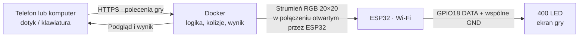
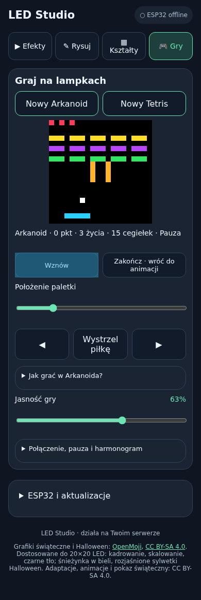
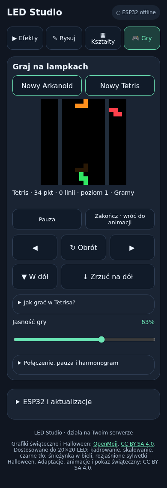

# Gry na matrycy LED 20×20

W studiu WWW jest zakładka **🎮 Gry** z dwiema prostymi grami: **Arkanoid** (paletka i cegiełki) oraz **Tetris** (spadające klocki). Są to własne, uproszczone implementacje, bez zewnętrznych grafik z gier.

Logika działa na serwerze Docker. ESP32 otrzymuje zwykłe klatki RGB przez dotychczasowy strumień HTTPS — nie wymaga aktualizacji firmware. Telefon jest kontrolerem, a lampki ekranem. Można też ćwiczyć wyłącznie na podglądzie przeglądarki bez połączonego ESP32.

## Jak ekran współpracuje z kontrolerem



Serwer oblicza ruch, odbicia piłki i ułożenie klocków. ESP32 wyświetla gotowy obraz; nie uruchamia silnika gry. Lampki zachowują własne zasilanie, zgodnie ze [schematem podłączenia](WDROZENIE.md#połączenia--zasilanie-z-usb-lampek).

## Potwierdzenie działania

11 listopada 2026 użytkownik potwierdził działanie funkcji gier na fizycznej matrycy LED. To potwierdzenie użytkowe, a nie pomiar opóźnienia ani deklaracja zgodności ze wszystkimi typami lampek.

Przed wdrożeniem przeszło **26 testów automatycznych backendu** oraz test mobilnej przeglądarki obejmujący dotyk, klawiaturę, wystrzelenie piłki, pauzę, wznowienie, zrzut klocka i powrót do wcześniejszej sceny. Zrzuty poniżej pochodzą z osobnej instalacji demonstracyjnej; dlatego pokazują „ESP32 offline” i nie zawierają danych prywatnego serwera.

## Uruchomienie

1. Ustaw na ESP32 źródło **Serwer zdalny** i sprawdź status online w studiu.
2. Otwórz studio na telefonie lub komputerze, przejdź do **Gry**.
3. Wybierz **Nowy Arkanoid** lub **Nowy Tetris**. Rozpoczęcie zastępuje ewentualną trwającą grę.
4. W Arkanoidzie naciśnij **Wystrzel piłkę**. Tetris uruchamia opadanie automatycznie.
5. Przyciskiem **Zakończ · wróć do animacji** przywrócisz poprzednią scenę, również jej wcześniejszy stan wyłączenia.

Harmonogram nadal obowiązuje. Poza dozwolonymi godzinami rozpoczęcie lub wznowienie jest odrzucane. Możesz zmienić godziny albo wyłączyć harmonogram w zwykłym panelu. Jeżeli przedział kończy się w trakcie gry, lampki gasną, a gra przechodzi w pauzę; później wymaga jawnego wznowienia.

## Sterowanie

| Akcja | Telefon | Klawiatura |
|---|---|---|
| Paletka / klocek w lewo lub prawo | Przyciski ◀ ▶, można przytrzymać | ← → |
| Dokładne ustawienie paletki | Suwak położenia | — |
| Wystrzelenie piłki | Wystrzel piłkę | Spacja |
| Obrót klocka | ↻ Obrót | ↑ |
| Przesunięcie klocka w dół | ▼ W dół, można przytrzymać | ↓ |
| Natychmiastowy zrzut klocka | ⤓ Zrzuć na dół | Spacja |
| Pauza / wznowienie | Przycisk Pauza / Wznów | P |

Klawiatura działa w zakładce gier, gdy fokus nie jest w polu formularza ani na przycisku. Po rozpoczęciu gry fokus trafia do planszy; w razie potrzeby kliknij planszę. Jasność gry ma osobny suwak i nie zmienia zapisanej jasności animacji.

### Arkanoid

Paletka znajduje się na dole, piłka jest biała, a cegiełki mają trzy kolory. Zbij wszystkie 15 cegiełek. Każda daje 10 punktów; dostępne są trzy życia, oznaczone także czerwonymi punktami u góry. Po stracie życia trzeba wystrzelić piłkę ponownie. Miejsce odbicia od paletki wpływa na kierunek lotu. Zielony dolny pasek oznacza wygraną, czerwony koniec gry.

### Tetris

Standardowe pole **10 kolumn × 20 wierszy** znajduje się pośrodku matrycy; jeden kwadrat klocka to jeden LED. Po prawej jest podgląd następnego klocka, a przygaszony cień wskazuje miejsce lądowania. Wypełnione linie znikają. Punktacja za 1/2/3/4 linie to 100/300/500/800 pomnożone przez poziom; opuszczanie i zrzut również dają punkty. Tempo rośnie co 10 linii.

Siedem rodzajów klocków jest losowanych w paczkach po siedem. Obrót próbuje niewielkiego przesunięcia przy ścianie; nie jest to pełna implementacja profesjonalnych zasad SRS. Gra kończy się, gdy nowy klocek nie mieści się na planszy.

## Pauza, zapis i wspólny ekran

- Przełączenie zakładki lub ukrycie okna wysyła pauzę. Jeśli telefon utraci połączenie albo zamkniesz stronę, brak sterowania przez 8 sekund również wstrzymuje grę.
- Sam powrót połączenia nie wznawia automatycznie przerwanej gry — użyj **Wznów**.
- Jedna instancja studia obsługuje **jedną wspólną grę**. Inni zalogowani użytkownicy mogą nią sterować lub rozpocząć nową. Wszystkie ESP32 połączone z tą instancją pokazują ten sam obraz.
- Stan gry i wynik są tylko w RAM. Restart serwera kończy rozgrywkę i przywraca zapisaną scenę. Nie ma trwałych rekordów ani zapisu rozgrywki.
- Wybranie innego efektu lub Play w bibliotece kończy grę. Ręczne „Zgaś” w zwykłym panelu również kończy grę i wyłącza scenę.
- Podczas awarii połączenia ESP32–serwer firmware może uruchomić lokalny efekt awaryjny. Gra nie działa wtedy na LED-ach; dostępna pozostaje na serwerze do czasu pauzy lub zakończenia.
- Odbiór jest oparty na istniejącym strumieniu około 20 FPS. Opóźnienia Wi-Fi i internetu wpływają na reakcję — to proste gry rekreacyjne, nie system gwarantujący stałą latencję.

## Podgląd mobilny

Zrzuty z lokalnego serwera demonstracyjnego bez fizycznego ESP32:

| Arkanoid | Tetris |
|---|---|
|  |  |

## Najczęstsze pytania

| Objaw / pytanie | Rozwiązanie |
|---|---|
| Nie widzę zakładki Gry | Zaktualizuj aplikację Docker i odśwież stronę; firmware ESP32 nie wymaga zmiany. |
| Podgląd działa, ale lampki pokazują inny efekt | Sprawdź, czy ESP32 jest online i ma źródło Serwer zdalny. |
| Nie mogę rozpocząć lub wznowić gry | Sprawdź godziny harmonogramu; poza przedziałem świecenia gry są blokowane. |
| Piłka stoi na paletce | Naciśnij Wystrzel piłkę lub spację, także po stracie życia. |
| Klawiatura nie reaguje | Kliknij planszę, aby przenieść fokus z pola formularza lub przycisku; zakładka Gry musi być aktywna. |
| Gra sama się zatrzymała | Sprawdź połączenie telefonu i harmonogram; po powrocie użyj Wznów. |
| Kierunki na lampkach są zamienione / obraz jest zygzakiem | Dopasuj układ wierszy, kolumn i zygzaka w lokalnym panelu ESP32. |
| Jak wrócić do dekoracji? | Wybierz Zakończ · wróć do animacji. Przywracany jest także wcześniejszy stan wyłączenia. |
| Czy wynik przetrwa restart Dockera? | Nie. Rozgrywka i wynik są przechowywane tylko w pamięci serwera. |

## API i testowanie

`GET /api/game` zwraca `game` oraz `schedule`. `POST /api/game` przyjmuje JSON:

```json
{"action":"start","kind":"arkanoid"}
```

Odpowiedź zawiera `game.id`. Kolejne polecenia wymagają tego identyfikatora:

```json
{"action":"launch","id":"ID_Z_ODPOWIEDZI"}
```

Akcje wspólne: `heartbeat`, `pause`, `resume`, `stop`, `brightness` (pole `value`: całkowite 0–255), `left`, `right`. Arkanoid: `launch`, `position` (`value`: liczba 0–19, ograniczana do szerokości paletki). Tetris: `rotate`, `down`, `drop`. Rozpoczęcie Tetrisa: `action=start`, `kind=tetris`.

Wymagane są Basic Auth i zgodny Origin, jak w API panelu. Nieaktualny identyfikator gry daje HTTP 409, aby opóźniony przycisk poprzedniej rozgrywki nie sterował nową. Nie jest to mechanizm wyłącznej własności gry przez jednego gracza. Klient wysyła heartbeat co 2 s, gdy zakładka gry jest widoczna. Stan gry jest również w `GET /api/state`, a obraz w `/api/preview` i zwykłym strumieniu urządzenia.

Testy `tests/test_games.py` obejmują fizykę piłki, życia i wygraną, zrzut klocków, kasowanie linii, obrót, kończenie gry, pauzę, harmonogram, autoryzację, odrzucanie starych poleceń i zachowanie zapisanej sceny. `tests/games_browser.cjs` sprawdza sterowanie mobilne i klawiaturę na tymczasowym localhost; szczegóły wymaganych zmiennych środowiskowych są takie jak w pozostałych testach przeglądarki.
