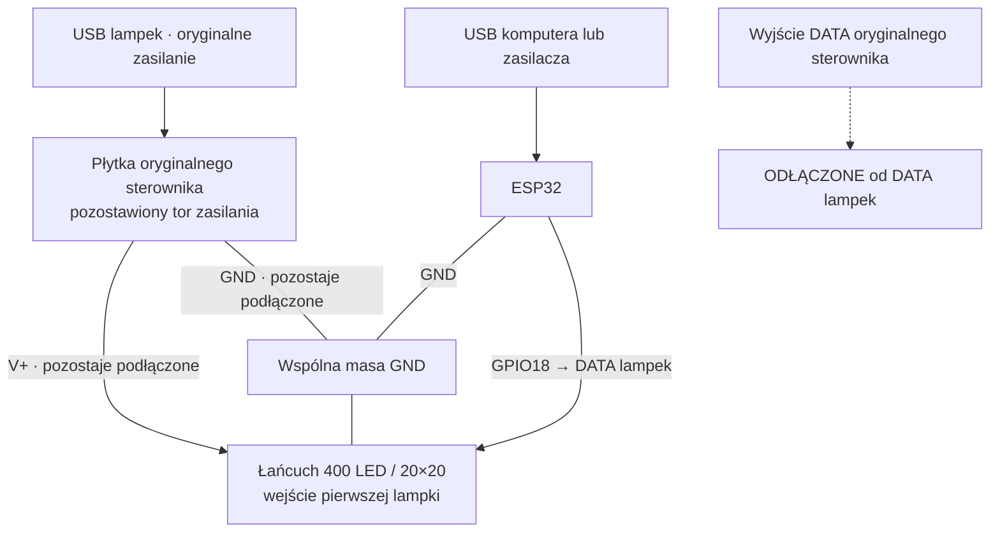

# Wdrożenie krok po kroku

W przykładach `led.example.com` oznacza **Twoją domenę**, `ADRES_ESP` adres przydzielony ESP32 przez DHCP, a `/dev/ttyUSB0` przykładowy port USB. Zastąp je własnymi wartościami. Serwer jest opcjonalny: generator lokalny działa samodzielnie.

## 1. Sprzęt i firmware

### Połączenia — zasilanie z USB lampek

W tym wariancie **lampki zachowują oryginalne zasilanie ze swojego USB**, przez płytkę sterownika. ESP32 ma własne zasilanie przez USB (komputer lub zasilacz USB). Między ESP32 a lampkami podłączamy tylko **DATA i GND**.



Schemat pokazuje połączenia funkcjonalne; ewentualny rezystor i konwerter poziomów umieść w torze DATA opisanym poniżej.

| Przewód / punkt | Co podłączyć |
|---|---|
| V+ lampek | Pozostaje na oryginalnej płytce, zasilanej z USB lampek |
| GND lampek | Pozostaje na oryginalnej płytce; do tej samej masy dołącz GND ESP32 |
| DATA prowadzące do lampek | Odłącz od wyjścia oryginalnego sterownika i podłącz do GPIO18 ESP32 |
| USB ESP32 | Osobne zasilanie ESP32 / programowanie |
| 3V3 i 5V/VIN ESP32 | Nie łącz z V+ lampek w tym wariancie |

**Nie łącz równolegle dwóch wyjść DATA.** Samo dolutowanie GPIO18 do działającego wyjścia oryginalnego sterownika może powodować konflikt. Odłącz przewód DATA od płytki lub przerwij wyłącznie jego ścieżkę od oryginalnego procesora. ESP32 ma sterować stroną prowadzącą do lampek. Oryginalny procesor może pozostać na płytce, ale jego DATA musi być odseparowane.

1. Odłącz oba USB przed zmianą przewodów.
2. Zidentyfikuj V+, GND i DATA na płytce; nie zakładaj funkcji na podstawie samego koloru przewodu.
3. Pozostaw V+ i GND lampek podłączone do oryginalnego toru zasilania.
4. Odłącz oryginalne DATA od lampek i podłącz wejście DATA lampek do GPIO18 ESP32.
5. Połącz GND ESP32 z GND lampek / płytki sterownika.
6. Podłącz USB lampek i USB ESP32. Pierwszy test wykonaj z niską jasnością, np. 24/255.

Rezystor szeregowy w DATA, typowo 220–470 Ω przy nadajniku, może pomóc ograniczyć odbicia; nie zastępuje konwersji poziomów. Jeśli wejście DATA lampek wymaga wyższego poziomu niż 3,3 V, zastosuj odpowiedni konwerter poziomów pomiędzy GPIO18 a DATA. Nie podawaj 5 V na GPIO ESP32. Numer GPIO18 nie oznacza osiemnastej fizycznej nóżki modułu.

Zasilacz USB i oryginalny tor zasilania muszą wystarczać dla poboru lampek. Nie zasilaj 400 LED z wyjścia 3V3 ESP32 ani nie łącz ze sobą dodatnich wyjść dwóch zasilaczy. Powyższy schemat zakłada pozostawienie oryginalnego toru zasilania, bez wymuszania innego napięcia na wyjściu płytki.

### Konfiguracja

Sklonuj projekt i utwórz lokalne pliki:

```bash
git clone https://github.com/michalzubryk/led-20x20-esp32-WIFI.git
cd led-20x20-esp32-WIFI
cp esp32_led_standalone/wifi_secrets.example.h esp32_led_standalone/wifi_secrets.h
cp esp32_led_standalone/remote_secrets.example.h esp32_led_standalone/remote_secrets.h
```

W `wifi_secrets.h` wpisz nazwę i hasło Wi-Fi **2,4 GHz**. W `remote_secrets.h` ustaw:

| Pole | Znaczenie |
|---|---|
| `REMOTE_HOST` | Domena serwera bez `https://` i bez ścieżki |
| `REMOTE_PORT` | Port HTTPS, np. 18443 |
| `DEVICE_TOKEN` | Ten sam losowy token co w `.env` serwera |
| `OTA_USER`, `OTA_PASSWORD` | Osobne dane logowania do aktualizacji ESP32 |

Do pracy wyłącznie lokalnej można zostawić przykładową domenę, ale ustaw własne hasło OTA. Nie wybieraj wtedy trybu serwera. Pliki z hasłami są ignorowane przez Git. **Skompilowana binarka również zawiera hasła i token — nie publikuj jej.**

### Kompilacja i USB

Sprawdzona wersja pakietu Arduino ESP32: **3.2.1**, płytka **ESP32 Dev Module**, domyślna partycja z OTA. W Arduino IDE otwórz `esp32_led_standalone/esp32_led_standalone.ino`, wybierz płytkę i port, skompiluj oraz wgraj. Nie wybieraj partycji „No OTA”.

Alternatywnie Arduino CLI (musi być wcześniej zainstalowane):

```bash
arduino-cli core update-index --additional-urls https://espressif.github.io/arduino-esp32/package_esp32_index.json
arduino-cli core install esp32:esp32@3.2.1 --additional-urls https://espressif.github.io/arduino-esp32/package_esp32_index.json
python3 esp32_led_standalone/prepare_assets.py
arduino-cli compile --fqbn esp32:esp32:esp32 --output-dir build esp32_led_standalone
arduino-cli upload --fqbn esp32:esp32:esp32 --port /dev/ttyUSB0 --input-dir build esp32_led_standalone
```

W Windows port może nazywać się `COM3`, a w macOS `/dev/cu.usbserial-...`. Jeśli upload zatrzymuje się na łączeniu, użyj przycisku BOOT zgodnie z instrukcją płytki. Zamknij monitor portu przed wysyłaniem klatek.

Adres ESP32 znajdziesz w liście DHCP routera lub logu szeregowym (921600 baud). Otwórz `http://ADRES_ESP/`. Zacznij od generatora i niskiej jasności. Wybierz układ wiersze/kolumny, zygzak lub bez, oraz kolejność RGB tak, aby obraz był prawidłowy.

## 2. Serwer Docker

Wymagania: Docker Engine z Compose, własna domena wskazująca serwer i prawidłowy certyfikat TLS dla tej domeny. ESP32 ufa korzeniom ISRG Root X1/X2 zapisanym w `remote_ca.h` (np. odpowiedni łańcuch Let's Encrypt). Samopodpisany certyfikat nie zadziała bez świadomej zmiany magazynu zaufania w firmware.

Na serwerze sklonuj repozytorium i przejdź do `remote_app`:

```bash
cd remote_app
cp .env.example .env
mkdir -p certs releases
chmod 700 certs
openssl rand -hex 24
openssl rand -hex 32
```

Wyniki wykorzystaj jako **różne** wartości `BASIC_PASSWORD` i `DEVICE_TOKEN` w `.env`; ustaw nazwę użytkownika `BASIC_USER`. Skopiuj token do konfiguracji firmware. `HTTPS_PORT` to publiczny port (domyślnie 18443), który również ustawiasz w `REMOTE_PORT`.

Umieść pełny łańcuch certyfikatu w `certs/fullchain.pem`, a klucz prywatny w `certs/privkey.pem`. Można skopiować istniejący certyfikat uzyskany przez ACME; nie kopiuj samych symlinków bez ich celów. Chroń klucz i `.env` uprawnieniami 600. Odnawianie certyfikatu musi aktualizować pliki w tym katalogu; aplikacja ponownie wczytuje je co godzinę. Po ręcznej wymianie można zrestartować usługę.

```bash
chmod 600 .env certs/privkey.pem
docker compose config --quiet
docker compose up -d --build
docker compose ps
docker compose logs --tail=50
```

Udostępnij w zaporze wybrany port TCP. Wejdź na `https://led.example.com:18443/` i zaloguj się danymi Basic Auth z `.env`. Sprawdź `https://led.example.com:18443/health` — powinno zwrócić `{"ok":true}`. ESP32 potrzebuje działającego DNS, dostępu do tego serwera oraz synchronizacji czasu NTP dla TLS. Nie przekierowuj portów do ESP32: połączenie do serwera jest wychodzące.

Dane sceny i biblioteki zapisują się w wolumenie `studio-data`. Nie używaj `docker compose down -v`, jeśli chcesz zachować bibliotekę. Kopię pliku stanu wykonuj przy zatrzymanej usłudze, np.:

```bash
docker compose stop
docker compose cp led400:/data/studio.json ./studio-backup.json
docker compose start
```

Kopia zawiera prywatne rysunki; przechowuj ją poza repozytorium. Przy pierwszym uruchomieniu przed zapisaniem sceny plik może jeszcze nie istnieć.

## 3. Uruchomienie i obsługa

1. W lokalnym panelu ESP32 wybierz **Serwer zdalny** i zapisz konfigurację.
2. Sprawdź status połączenia i rosnący licznik klatek.
3. Na telefonie otwórz studio, wpisz tekst i wybierz „Pokaż na lampkach”.
4. W zakładce rysowania narysuj kształt, dodaj klatki i zapisz. W bibliotece naciśnij Play.
5. Wybrany obraz pozostaje aktywny; animacja powtarza swoje klatki. Pokaz wielu motywów uruchamia się osobno.

Pakiet świąteczny zaimportuj z komputera z Pythonem (importer zapyta o login i hasło, nie zmienia aktualnej sceny):

```bash
python3 remote_app/christmas/import_shapes.py --url https://led.example.com:18443
python3 remote_app/christmas/import_shapes.py --url https://led.example.com:18443 --animated
```

Importer pomija nazwy istniejące już w bibliotece. Wbudowane grafiki są w repozytorium, więc nie trzeba pobierać ich ponownie. `prepare.py` odtwarza obrazy z OpenMoji (wymaga internetu i Pillow), a `animate.py` generuje animacje.

### GIF / USB / DDP

W panelu ESP32 przełącz źródło na **Aplikacja USB / DDP**. Zainstaluj zależności nadajnika:

```bash
python3 -m venv .venv
. .venv/bin/activate
pip install Pillow pyserial
python esp32_led_stream/stream.py --port /dev/ttyUSB0 --pattern rainbow --seconds 30
python esp32_led_stream/stream.py --host ADRES_ESP --image animacja.gif --seconds 60 --fps 30
```

Obrazy są skalowane do 20×20. Nadajnik stosuje mapowanie `--layout` i `--order` samodzielnie (domyślnie kolumny, RGB). `--brightness` przyjmuje 0–255. GIF zachowuje czasy klatek, a pętla wysyłania próbuje osiągnąć wybrane FPS; to nie gwarancja fizycznego odświeżania. USB i UDP działają tylko w trybie stream. UDP nie ma logowania — używaj zaufanej sieci LAN.

### OTA bez kabla

Po pierwszym wgraniu USB otwórz `http://ADRES_ESP/update`, zaloguj się danymi `OTA_USER`/`OTA_PASSWORD` i wyślij **`esp32_led_standalone.ino.bin`** z katalogu `build`. Możesz zrobić to z telefonu. Nie wysyłaj obrazu merged, bootloadera ani tablicy partycji.

Alternatywnie umieść tę binarkę na swoim serwerze jako `remote_app/releases/led400.bin` i w panelu ESP32 wybierz „Aktualizuj z serwera”. Aktualizacja sprawdza nagłówek/chip, a pobranie z serwera także SHA-256. Pozostaw zasilanie do końca operacji; ESP uruchomi się ponownie. Hasła Wi-Fi i token muszą być poprawne w nowej kompilacji. Nie ma automatycznego cofnięcia wadliwego działającego obrazu — odzyskiwanie przez USB.

Lokalny panel używa HTTP i nie jest przeznaczony do wystawiania w internecie. Basic Auth chroni OTA, ale nie szyfruje lokalnego HTTP.

## Rozwiązywanie problemów

| Objaw | Co sprawdzić |
|---|---|
| Brak LED | Zasilanie, wspólną masę, kierunek DATA, GPIO18 i zgodność protokołu |
| Złe kolory / poszarpany obraz | RGB/GRB, kolumny/wiersze/zygzak, jakość sygnału i poziomy logiczne |
| ESP nie łączy się z Wi-Fi | Sieć 2,4 GHz, hasło i zasięg; adres w DHCP |
| Serwer offline | Domena, port, zapora, token, pełny łańcuch TLS i synchronizacja czasu |
| Po chwili wraca lokalny efekt | Zadziałał fallback — sprawdź połączenie i status ESP |
| GIF nie zmienia LED | Źródło musi być stream; zamknij monitor szeregowy; sprawdź adres/port |
| HTTP 401 | Dane Basic Auth panelu lub token urządzenia, zależnie od endpointu |
| OTA odrzucone | Obraz aplikacji dla klasycznego ESP32, rozmiar partycji, login i hasło |
