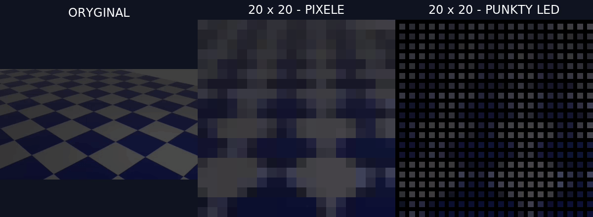

# Film na matrycy 20×20 — demonstracja i możliwość rozwoju

**Da się wyświetlać film jako kolejne klatki 20×20.** Próba konwersji została wykonana na komputerze: 20×20 RGB, 20 klatek/s, około 3,15 s. Nie był to test odtwarzania tego filmu na fizycznych lampkach i nie zmieniał firmware ESP32.



[Pobierz porównanie MP4](video/porownanie.mp4). Po lewej oryginał; w środku środkowy kwadratowy kadr po zmniejszeniu i powiększeniu bez wygładzania; po prawej ten sam obraz z odstępami między punktami. Odstępy i jasność na ekranie nie odwzorowują dokładnie fizycznych LED.

## Co jest już dostępne, a co wymaga implementacji

- Nadajnik Python już obsługuje obrazy i GIF-y przez USB/DDP.
- ESP32 już odbiera gotowe klatki RGB; serwer generuje strumień około 20 FPS.
- **Panel WWW nie obsługuje jeszcze importowania i dekodowania AVI/MP4.** To możliwość dalszego rozwoju: upload, przycięcie/dopasowanie obrazu, konwersja do 20×20, odtwarzanie i pętla.
- Docelowy przepływ: plik AVI/MP4 → dekoder na serwerze lub komputerze → RGB 20×20 → istniejący transport → ESP32. ESP32 nie musi dekodować kodeka filmu.

Surowe klatki przy 20 FPS to 20 × 20 × 3 × 20 = **24 000 bajtów/s**, bez narzutu protokołów. To wyliczenie rozmiaru danych, nie pomiar wydajności konkretnego filmu.

## Przykładowa konwersja FFmpeg

Dla filmu poziomego lub kwadratowego (kadr przycinany do kwadratu w środku):

```bash
ffmpeg -i wejscie.avi -an -vf 'fps=20,crop=ih:ih,scale=20:20:flags=area,setsar=1' -c:v ffv1 film_20x20.avi
ffmpeg -i film_20x20.avi -vf 'scale=400:400:flags=neighbor' -c:v libx264 -pix_fmt yuv420p podglad.mp4
```

Można także podać MP4 jako wejście. Dla pionowego filmu trzeba zmienić kadrowanie. FFV1 to bezstratny kodek w pliku demonstracyjnym AVI (np. do odtwarzania w VLC), nie format odbierany przez ESP32. Podgląd 400×400 nadal zawiera wyłącznie informacje z 400 pikseli. Dźwięk jest pomijany.

Najlepiej wypadają duże sylwetki, proste animacje, ogień i efekty o mocnym kontraście. Twarze, tekst i detale tła zwykle tracą czytelność. Odbijająca się piłka zachowuje ruch, ale jej szczegóły zanikają. Zastosowanie jest przede wszystkim dekoracyjne.

## Źródło i licencja przykładu

„Bounce-ball.webm”, autor **Thecd3m**, [Wikimedia Commons](https://commons.wikimedia.org/wiki/File:Bounce-ball.webm), [CC BY-SA 4.0](https://creativecommons.org/licenses/by-sa/4.0/). Zmiany: przycięcie, zmniejszenie, 20 FPS, powiększenie pikseli, siatka i zestawienie porównawcze. Przetworzone GIF i MP4 również CC BY-SA 4.0; nie obejmuje ich licencja MIT kodu projektu.
