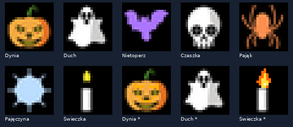

# Halloween — pakiet 20×20

Siedem obrazów: dynia, duch, nietoperz, czaszka, pająk, pajęczyna i świeczka. Trzy animacje: dynia ze świecącymi oczami, lewitujący duch i świeczka z migoczącym płomieniem. Po wybraniu Play motyw pozostaje aktywny; animacja powtarza wyłącznie własne klatki.

[Zrzut biblioteki na telefonie (instalacja demonstracyjna)](../../docs/screenshots/halloween.png).



Import na własny serwer (skrypt zapyta o login i hasło):

```bash
python3 remote_app/halloween/import_shapes.py --url https://led.example.com:18443
```

Importer pomija istniejące nazwy i nie zmienia wybranego obrazu ani harmonogramu. W WWW otwórz **Moje kształty → Halloween**. Animowana świeczka jest również widoczna przez filtr **Animowane**. `prepare.py` odtwarza pakiet; wymaga Pillow i przy pierwszym uruchomieniu internetu.

Źródłowe ilustracje: [OpenMoji](https://openmoji.org/), [OpenMoji contributors](https://github.com/hfg-gmuend/openmoji), **CC BY-SA 4.0**. Pełna licencja: `LICENSE.txt`; adresy oryginałów i SHA-256: `sources.json`. Modyfikacje: kadrowanie, skalowanie do 20×20, czarne tło, rozjaśnienie sylwetek nietoperza, pająka i pajęczyny, dodatkowe świecące piksele dyni, ruch ducha oraz zmienny płomień świecy. Adaptacje i klatki animacji również CC BY-SA 4.0.
